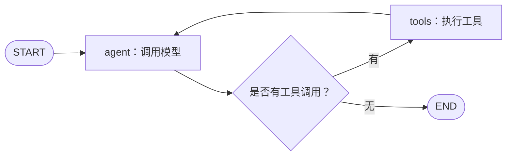
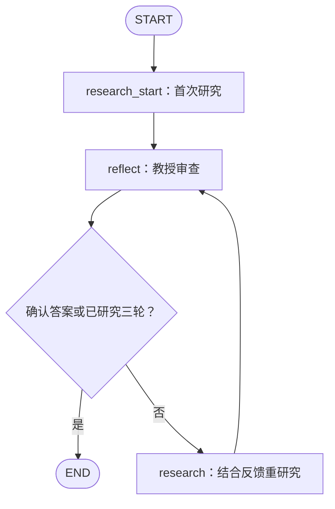

# LangGraph 入门：从状态、节点和边，到一个会反思的问答 Agent

## 一、LangChain 和 LangGraph，应该怎么选？

可以先用两个比喻建立直觉：

**LangChain 更像工具箱，LangGraph 更像工作流引擎。**


但不要因此得出“LangChain 只能直线执行，LangGraph 才能做 Agent”的结论。当前 LangChain 的 `create_agent` 本身就建立在 LangGraph 之上，已经封装了模型与工具之间的循环。两者不是必须二选一的替代品。

更实际的选择标准是：**你需要自己控制多少流程？**

如果只是让模型根据问题选择工具、拿到结果后回答，先用 `create_agent` 就够了。如果业务明确要求“先研究、再审查，不通过则带着反馈重新研究，最多三轮”，那么这些步骤值得用 LangGraph 显式组织。

本文恰好把两者组合起来：用 LangChain 构建研究员的工具调用能力，用 LangGraph 编排外层的研究和审查。

图也不只服务于 Agent。固定顺序的数据处理、并行检查和人工审批，都可以建模成图。对于本文，图最有价值的地方是把循环和退出规则从提示词中拿出来，变成可以阅读、检查的程序结构。

## 二、LangGraph 就是一张图：状态、节点、边

先看一个最小的工具调用型 Agent：



模型产生工具调用请求，工具执行后把结果交回来，模型再决定下一步。这张图能够循环，关键就在 `tools → agent` 这条返回边。

理解它，只需要三个概念。

### State：执行过程中的共享数据

State 可以理解为当前这次运行的工作台。用户问题、已有答案、审查意见和轮数，都可以放在上面，供后续节点读取。

在工具调用型 Agent 中，常见的核心字段是 `messages`：用户消息、模型消息、工具调用请求和工具结果按顺序进入消息列表。LangGraph 提供的 `MessagesState` 也围绕这个需求设计。

但 State 并不一定要包含消息列表。业务关心哪些数据，就应该明确表达哪些数据。本文外层图保存的是题目、答案、反馈和轮数；内部研究员才使用消息列表。这两个层次不要混在一起。

另外，共享状态并不自动等于跨会话的长期记忆。本文没有配置持久化检查点，讨论的只是一次运行内的数据传递。

### Node：读取状态，完成一件事

节点通常就是一个 Python 函数：接收当前状态，执行任务，返回需要更新的字段。

一个节点可以调用 LLM，也可以查数据库、执行工具，甚至只做普通的条件计算。它的边界由业务决定，并不要求“一次模型调用必须对应一个节点”。

节点通常不必返回整个状态。例如研究员完成回答后，只需返回答案与轮数，题目和选项仍然保留。

### Edge：决定接下来执行谁

边负责组织控制流。静态边表示固定跳转，例如研究完成后一定进入审查；动态路由表示根据结果选择下一步，例如通过审查则结束，否则重研究。

`START` 和 `END` 分别标记入口和出口，不是需要我们编写函数的业务节点。

可以把三者记成一句话：**State 保存数据，Node 完成工作，Edge 组织顺序。**

## 三、先画设计图：一个会接受反馈的问答 Agent

现在把通用概念换成具体任务。我们从 MMLU 中取一道地理选择题，让研究员检索并作答，再交给教授审查。

教授有两种主要输出：确认答案，或者给出需要补充调查的意见。后者会成为下一轮研究的输入。

外层工作流如下：



图中的菱形是对判断逻辑的解释，不是源码里额外注册的节点。实际代码在 `reflect` 中通过 `Command` 决定去向。

这里还有一个容易忽略的结构：研究员内部也有循环。它可能多次调用搜索工具，再形成一份答案。外层把这整段过程视为一个研究节点。

因此，我们有两层不同的循环：

| 层次 | 循环内容 | 负责者 |
|---|---|---|
| 内层 | 模型请求工具 → 工具返回 → 模型继续回答 | LangChain `create_agent` |
| 外层 | 研究 → 审查 → 携带反馈重新研究 | 自定义 LangGraph |

这也解释了为什么“最多研究三轮”不等于“最多调用三次模型”：一次研究内部就可能包含多个模型请求和工具调用。

项目文件按职责拆分：

```text
langgraph-qa-agent
├── requirements.txt
└── qa_agent
    ├── llm.py       # 模型配置
    ├── tools.py     # 检索工具
    ├── agents.py    # 两类研究员和审查链
    ├── graph.py     # 状态、节点、路由与编译
    ├── trace.py     # 节点更新日志
    └── run.py       # MMLU 加载和运行入口
```

接下来沿着 State → Node → Edge 的顺序阅读核心代码。

## 四、动手实现：把设计变成代码

### 1. 准备环境和模型

进入项目并安装依赖：

```powershell
cd .\langgraph-qa-agent
python -m venv .venv
.\.venv\Scripts\Activate.ps1
python -m pip install -r .\requirements.txt
```

在项目目录的 `.env` 中配置以下变量，填入密钥与模型名称：

```dotenv
DASHSCOPE_API_KEY=你的密钥
DASHSCOPE_MODEL_NAME=你的模型名称
```

创建`llm.py` 通过 `load_dotenv()` 加载配置，再调用 `init_chat_model`：

```python
llm = init_chat_model(
    model=model_name,
    model_provider="openai",
    api_key=api_key,
    base_url="https://token-plan.cn-beijing.maas.aliyuncs.com/compatible-mode/v1",
    temperature=0.7,
    max_retries=3,
    timeout=90,
)
```

当前地址是项目采用的通义千问服务入口，使用其他服务方案时，需要按对应文档调整地址和模型名称，不能假定任意 DashScope Key 都能使用它。

### 2. State：明确节点之间传什么

`graph.py` 中的状态定义如下：

```python
from typing import Optional, TypedDict

class ReflectionAgentState(TypedDict):
    question: str
    options: str
    current_answer: Optional[str]
    feedback: Optional[str]
    steps: int
```

`question` 和 `options` 是稳定输入，`current_answer` 保存最新答案，`feedback` 保存教授意见，`steps` 统计研究轮数。

这些字段没有指定 reducer，顺序执行时更新会覆盖旧值。新答案替换旧答案，新反馈替换旧反馈，正好符合当前需求。若要累计消息，则需要 `add_messages` 等合并规则；不能把“列表天然会追加”当作默认行为。

`TypedDict` 主要提供结构和类型提示，不会自动初始化字段。当前入口只传入题目和选项，首次研究节点再写入答案与轮数；后续节点读取字段时，要保证前面的节点已经产生它们。

这里故意不把 MMLU 标准答案放进 State：研究员和教授都不应该提前看到答案键。

### 3. Node：研究员怎样完成一次研究

先构建节点依赖的研究员组件。以下是 `agents.py` 的核心：

```python
from langchain.agents import create_agent

def create_research_agent():
    return create_agent(
        model=get_llm(),
        tools=get_tools(),
        system_prompt=(
            "你是一个研究员。请使用你的工具搜索信息，"
            "解答用户的选择题，并给出你的论证过程。"
        ),
    )
```

`get_tools()` 加载 `ddg-search`、`arxiv` 和 `wikipedia`，并加上项目自己的错误处理。工具可用并不意味着模型每次都会调用；提示词提出了检索要求，但实际调用仍需要观察日志确认。

当前 API 的输入是消息，输出也包含消息。封装函数将业务问题转成用户消息，再提取最终文本：

```python
def _ask(agent, content: str) -> str:
    result = agent.invoke({
        "messages": [{"role": "user", "content": content}]
    })
    return result["messages"][-1].text
```

不要直接套用旧版 `AgentExecutor` 的 `result["output"]`，也不要把题目字段直接传给这个消息接口。项目中的 `run_research` 负责拼接题目、选项并调用 `_ask`。

有了组件，外层首次研究节点就很简单：

```python
def research_start(state: ReflectionAgentState):
    result = run_research(
        initial_researcher, state["question"], state["options"]
    )
    return {"current_answer": result, "steps": 1}
```

它读取两个字段，只更新两个字段。题目没有被重新返回，却仍然保存在图状态中。

重研究节点多读取上一版答案和教授意见：

```python
def research(state: ReflectionAgentState):
    result = run_critique_research(
        critique_researcher,
        state["question"],
        state["options"],
        state["current_answer"],
        state["feedback"],
    )
    return {
        "current_answer": result,
        "steps": state.get("steps", 0) + 1,
    }
```

`run_critique_research` 把这些信息放进新的提示词。因此，重研究不是无条件重复提问，而是显式携带“上一轮答了什么、下一轮要改什么”。

### 4. 让教授返回结构，而不是猜测一段文本

如果教授只回复“看起来可以，但最好再查一下”，程序很难稳定判断是否结束。我们用 Pydantic 定义两个字段，再通过 `with_structured_output` 获取结构化结果：

```python
from pydantic import BaseModel, Field

class ReflectionResponse(BaseModel):
    answer: Optional[str] = Field(
        default=None, description="确认的答案及简短理由；未确认时留空"
    )
    critique: Optional[str] = Field(
        default=None, description="需要进一步调查的意见；确认后留空"
    )

structured_llm = get_llm().with_structured_output(ReflectionResponse)
```

项目再把教授角色提示词与 `structured_llm` 组成一条链，输入题目、选项和研究员答案。

不过，结构正确不等于业务语义正确。这个模型定义允许两个字段都有值，也允许都为空，并没有强制“二选一”。真正的通过条件必须在路由代码里写清楚。

## 五、从静态结构到动态循环：边和 Command

先声明固定的执行顺序：

```python
from langgraph.graph import END, START, StateGraph

workflow = StateGraph(ReflectionAgentState)
workflow.add_node("research_start", research_start)
workflow.add_node("research", research)
workflow.add_node("reflect", reflect)

workflow.add_edge(START, "research_start")
workflow.add_edge("research_start", "reflect")
workflow.add_edge("research", "reflect")
```

无论首次研究还是重研究，完成后都去教授那里。但教授之后该去哪里，要等审查结果出来。

LangGraph 可以通过 `add_conditional_edges` 注册独立路由函数。本 Demo 使用另一种方式：节点返回 `Command`，同时更新状态并指定下一步。

```python
from typing import Literal
from langgraph.types import Command

MAX_STEPS = 3

def reflect(state: ReflectionAgentState) -> Command[
    Literal["research", "__end__"]
]:
    reflection = reflection_chain.invoke({
        "question": state["question"],
        "options": state["options"],
        "research_result": state["current_answer"],
    })
    answer, critique = reflection.answer, reflection.critique
    approved = bool(answer) and not critique
    goto = (
        END
        if approved or state.get("steps", 0) >= MAX_STEPS
        else "research"
    )
    return Command(
        update={
            "current_answer": answer or state["current_answer"],
            "feedback": critique,
        },
        goto=goto,
    )
```

读这段代码时，可以先分开看两件事。

`update` 表示“这一轮改什么”。教授没给答案时，保留研究员草稿，避免用 `None` 覆盖它；给出非空答案时则采用该文本，即使这轮仍有 critique。

`goto` 表示“下一步去哪”。只有给出答案且没有 critique，才算确认。两个字段同时出现或同时为空，都不算通过；未达到上限时继续研究。

这不是理论上的边界。实际组件测试中，教授曾同时返回“C. 都是”和一段表示赞同的 critique。人读起来像确认，程序按照明确规则仍会继续。因此提示词不能替代业务判断，结构化输出也不能替代路由规则。

轮数只由研究节点更新：首次写入 1，每次重研究加 1。教授只读取，避免重复计数。达到三轮就结束，即使教授仍不满意。

注意，这个限制只约束外层研究轮数，不是整个程序的总时长限制，更不能终止所有底层网络请求。

`reflect` 已通过 `Command` 决定去向，不需要再添加一条固定的 `reflect → research` 边。否则静态跳转不会因为返回 `Command` 就自动消失，可能形成额外执行路径。

最后编译：

```python
app = workflow.compile()
```

编译把图定义变为可运行对象，并进行基本结构检查；它不会替我们调用模型，也不会证明工具联网正常。至此，State、Node、Edge 才真正组合成一张可执行的图。

### 跟着一份状态，走过两轮研究

为了确认自己理解了循环，可以暂时放下提示词，手工追踪一次状态变化。下面是说明控制流的假设场景，不是真实运行日志：

| 时刻 | 最新答案 | 教授反馈 | 研究轮数 | 下一步 |
|---|---|---|---|---|
| 输入题目 | 尚未生成 | 尚未生成 | 尚未写入 | 首次研究 |
| 首次研究结束 | 初稿 B | 尚未生成 | 1 | 审查 |
| 首次审查结束 | 保留初稿 B | 请补充权威依据 | 1 | 重研究 |
| 重研究结束 | 修订答案 B | 保留上一轮反馈 | 2 | 审查 |
| 第二次审查确认 | 教授确认的 B | 空 | 2 | 结束 |

这里有两个细节值得停下来想一想。

第一，重研究节点没有清空 `feedback`，因此旧反馈会暂时保留，直到教授再次写入。状态不是每执行一个节点就重新创建一份空字典，而是依据节点返回的字段持续更新。阅读某个字段时，必须结合它最近由谁写入，不能只看当前节点的返回值。

第二，前后答案都可能是 B，但这不代表第二轮没有发生工作。重研究修改的可能是证据、理由或对其他选项的排除过程。本文保存的是整段答案文本，不只保存一个选项字母。

如果第二次审查依然提出意见，流程会进入第三轮研究。第三轮之后无论是否确认，都会结束，并保留当时最新的答案。这种结束属于预算限制，不是质量保证。在现有输出中，需要结合最后的反馈与轮数判断结束原因，不能看到“最终结果”四个字就认为教授已经批准。

这种手工追踪也是检查图设计的简单方法：沿着每条路径，问清楚谁写入字段、谁读取字段、什么条件让路径终止。先让数据与控制流对得上，再接真实模型，定位问题会容易得多。

## 六、加载一道 MMLU 题目，流式观察运行

### 数据如何进入图

`run.py` 使用 Hugging Face Datasets 加载指定科目：

```python
dataset = load_dataset(
    "cais/mmlu", "high_school_geography", split="test"
)
sample = dataset[0]
```

样本包含 `question`、`subject`、`choices`、`answer`。其中 `choices` 是字符串列表，`answer` 是从 0 开始的选项索引。

入口将选项转换成 A、B、C、D 的展示形式：

```python
choices = sample["choices"]
options = "\n".join(
    f"{chr(ord('A') + index)}. {choice}"
    for index, choice in enumerate(choices)
)
inputs = {"question": sample["question"], "options": options}
```

标准答案留在入口中，只在结束后打印。这里借用 MMLU 提供一道真实问题，并没有进行基准评测，更没有用一道题计算准确率。

### 为什么用 astream

一次性调用 `invoke` 可以拿到最终状态，但入门时更值得看到节点如何更新数据。入口因此使用异步流：

```python
async def run() -> None:
    # 此处省略上面的数据加载和 inputs 构造
    agent_answer = None
    async for _, updates in graph.astream(
        inputs, stream_mode=["updates"]
    ):
        for node_name, event in updates.items():
            log_event(node_name, event)
            if "current_answer" in event:
                agent_answer = event["current_answer"]

    if not agent_answer:
        raise RuntimeError("图运行结束，但未产生 Agent 答案。")

    print(f"Agent 答案：\n{agent_answer}")
    print(f"MMLU 标准答案：\n{reference_answer}")

if __name__ == "__main__":
    asyncio.run(run())
```

由于传入的是模式列表 `["updates"]`，当前事件按“模式、数据”解包；`updates` 再按节点名组织状态增量。`log_event` 打印这些增量，入口保留最新答案供最终展示。

要特别区分“节点更新流”和“模型 token 流”。当前节点内部仍使用同步 `invoke`，外层 `astream` 不会自动把研究员的每个动作变成实时输出。一个研究节点还没完成时，终端可能一直停留在“开始首次研究”。

同样，外层状态没有 `messages`，所以当前日志不能完整展示内部工具调用。虽然 `log_event` 能识别带工具调用的消息，但前提是事件确实携带它们。不能把这套日志描述成完整的工具追踪或模型内部思考记录。

运行命令如下：

```powershell
python -m qa_agent.run
```

入口也支持 `python .\qa_agent\run.py`；模块方式能更直接地保持包导入语义，建议文章统一使用前者。


## 结语：先让控制流清楚，再谈 Agent 更聪明

回看这个 Demo，LangGraph 并没有替我们决定正确答案。它提供的是一种组织程序的方法：用 State 明确传递的数据，用 Node 划分工作，用 Edge 和 Command 明确下一步与退出条件。

当教授提出 critique，反馈不是停留在一段文字里，而是进入状态、触发重研究；当达到上限，程序也不会把“继续努力”无限重复下去。

这就是从一次模型调用走向可控 Agent 的第一步。先把流程画清楚、写清楚、观察清楚，再讨论检索质量、答案可靠性，以及后续真正需要的评测。

---

### 代码与参考资料

- [本项目代码与运行说明](../langgraph-qa-agent/README.md)
- [LangChain Agents 官方文档](https://docs.langchain.com/oss/python/langchain/agents)：核对 `create_agent` 与工具调用循环。
- [LangGraph Graph API 官方文档](https://docs.langchain.com/oss/python/langgraph/graph-api)：核对 State、Node、Edge 与编译。
- [LangGraph 基本概念介绍](https://mlwithme.github.io/agent/chapter04/langgraph-basics/)：参考概念组织与可视化讲解方式。
- [LangGraph Workflows: Sequential & Parallel](https://pub.towardsai.net/langgraph-workflows-sequential-parallel-0924548089f5)：参考把独立任务与执行结构分开讲解的方法；本文采用有依赖的研究—审查循环，不扩展并行工作流。
- 项目方案另参考仓库中的 `references/generative_ai_with_langchain/chapter6/question_answering.ipynb`，本文以当前 LangChain 1.x 实现为准。
